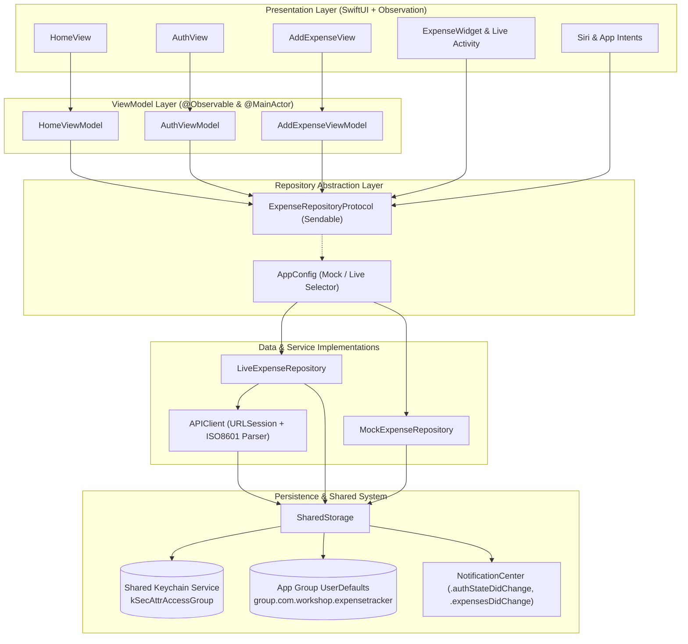

# 🏛️ Expense Tracker — System Architecture & Design Documentation

## 1. Architectural Overview

Expense Tracker is structured around the **SwiftUI MVVM (Model-View-ViewModel)** architectural pattern augmented by a protocol-driven **Repository Pattern** and modern Swift Concurrency.

The architecture emphasizes:
- **Unidirectional Data Flow**: State flows downward from ViewModels to Views; user actions flow upward via explicit method invocations.
- **Protocol-Driven Abstraction**: Complete decoupling between UI presentations and data sources via `ExpenseRepositoryProtocol`.
- **Dual Runtime Pipeline**: Seamless switching between a live REST service (`LiveExpenseRepository`) and an offline simulated repository (`MockExpenseRepository`).
- **Cross-Process Data Sharing**: Secure communication and shared cache between the main iOS application and WidgetKit extensions via App Groups and Shared Keychain.
- **Swift 6 Concurrency Compliance**: Strict separation between `@MainActor` UI layers and background `Sendable` networking/storage services.

---

## 2. High-Level Architecture Diagram



---

## 3. Layer Breakdown

### 3.1 Presentation Layer (Views)
- **Declarative SwiftUI Views**: `HomeView`, `AuthView`, `AddExpenseView`, and custom components (`TopCategoryPillView`, `ExpenseRowView`).
- **Zero Business Logic**: Views are pure rendering mechanisms that observe ViewModels via the Swift `Observation` framework (`@Observable`).
- **Modern iOS 17+ Features**:
  - `.contentTransition(.numericText())` for animated currency value updates.
  - Interactive `.sheet(presentationDetents: [.medium, .large])` for fluid expense entry.
  - Contextual `.swipeActions(edge: .trailing)` for deletion.
  - Dynamic type and accessibility labels throughout.

### 3.2 ViewModel Layer (`@Observable` & `@MainActor`)
- ViewModels (`HomeViewModel`, `AuthViewModel`, `AddExpenseViewModel`) manage UI-specific state:
  - `isLoading`, `errorMessage`, `groupedExpenses`, `monthlyTotal`, `todayTotal`, `topCategories`.
- Enforces `@MainActor` isolation to guarantee UI thread safety.
- Exposes computed aggregations (e.g. daily section groupings with subtotals) without modifying core domain models.
- Interacts purely with `ExpenseRepositoryProtocol`, making ViewModels 100% testable via mock injection.

### 3.3 Domain & Repository Layer
- **`ExpenseRepositoryProtocol`**: Formal contract defining CRUD operations, session management, and summary queries:
  ```swift
  protocol ExpenseRepositoryProtocol: Sendable {
      func login(email: String, password: String) async throws -> AuthResponse
      func register(email: String, password: String) async throws
      func logout()
      func fetchExpenses(from: Date?, to: Date?) async throws -> [Expense]
      func addExpense(amount: Double, currency: String, category: ExpenseCategory, note: String?, date: Date) async throws -> Expense
      func deleteExpense(id: UUID) async throws
      func fetchSummary(period: String, days: Int?, topCategories: Int?) async throws -> ExpenseSummary
      func seedDemo() async throws
  }
  ```
- **`LiveExpenseRepository`**:
  - Talks to the hosted ASP.NET Core backend through `APIClient`.
  - Automatically writes summaries to `SharedStorage` on every transaction to keep widgets updated.
  - Triggers `WidgetCenter.shared.reloadAllTimelines()` on data modifications.
- **`MockExpenseRepository`**:
  - In-memory data store protected by `NSLock` for concurrent mutations.
  - Generates realistic pre-seeded expenses.
  - Calculates live summaries in-memory, updating `SharedStorage` for offline widgets.
- **`AppConfig`**:
  - Shared configuration reading from App Group `UserDefaults`.
  - Dynamically returns either `LiveExpenseRepository` or `MockExpenseRepository` based on user selection.

### 3.4 Networking Layer (`APIClient`)
- Base URL: `https://expensetracker-workshop.runasp.net`
- Asynchronous networking with `URLSession.shared.data(for:)`.
- **Custom ISO-8601 Date Parsing**:
  - Handles variable backend datetime formats: fractional seconds (`yyyy-MM-dd'T'HH:mm:ss.SSSSSSS`), standard ISO-8601, and date-only fallbacks.
- **Automatic Bearer Token Injection**: Extracts Bearer token from `SharedStorage` and populates the `Authorization: Bearer <token>` header on authenticated endpoints.
- Robust error mapping using `APIErrorResponse` and `APIError`.

### 3.5 Storage & Security Architecture (`SharedStorage`)
- **Shared Keychain**:
  - Stores the authentication token under service `com.workshop.expensetracker.auth` and account `bearer_token`.
  - Uses Keychain Access Group `$(AppIdentifierPrefix)com.workshop.expensetracker.shared`.
  - Includes a fallback for Xcode Simulator runs where Keychain Access Groups require custom provisioning profiles.
- **App Group `UserDefaults` (`group.com.workshop.expensetracker`)**:
  - Caches latest `ExpenseSummary` records per period (`day`, `week`, `month`).
  - Shared across target boundaries, allowing the Widget Extension to display cached summaries with zero latency.
  - Maintains `lastSummaryUpdateDate` to inform widgets whether data is fresh or offline.

---

## 4. Extension Architecture

### 4.1 WidgetKit (`ExpenseWidget`)
- Powered by `AppIntentTimelineProvider` and `SummaryWidgetConfigurationIntent`.
- **Dual Form Factor Support**:
  - `.systemSmall`: Compact circular period badge, total amount, primary category, and offline cache status icon (`icloud.slash`).
  - `.systemMedium`: Two-column layout with period selector, formatted total, sync badge (Green "Synced" vs Orange "Cached Offline"), and top 3 spending categories list.
- **Graceful Offline Degradation**:
  ```mermaid
  sequenceDiagram
      participant W as Widget Timeline
      participant P as ExpenseWidgetProvider
      participant R as LiveExpenseRepository
      participant SS as SharedStorage (App Group)

      W->>P: Request Timeline Entry
      P->>R: Fetch Summary (period)
      alt Network Available
          R->>SS: Save fresh summary
          R-->>P: Return fresh summary (isCachedOffline: false)
      else Network Unavailable / Offline
          R-->>P: Network error
          P->>SS: getSummary(forPeriod:)
          SS-->>P: Return cached snapshot
          P-->>W: Render cached summary (isCachedOffline: true)
      end
  ```

### 4.2 App Intents & Siri Shortcuts (`ExpenseIntents.swift`)
- **`AddExpenseIntent`**:
  - Enables voice or shortcut execution: *"Log an expense in Expense Tracker"*.
  - Parameterized with amount, category (`ExpenseCategory`), and optional note.
  - Supports conversational value requests via `requestValueDialog` if arguments are missing.
  - Returns customized SwiftUI snippet cards (`AddedExpenseSnippetView`).
- **`GetSummaryIntent`**:
  - Voice query: *"How much did I spend in Expense Tracker"*.
  - Spoken response via `IntentDialog` synthesizing period spending and top spending categories.
  - Displays `ExpenseSummarySnippetView` in Siri modal overlays.
- **`ExpenseShortcutsProvider`**:
  - Automatically publishes predefined shortcuts to the iOS Shortcuts app on app launch via `ExpenseShortcutsProvider.updateAppShortcutParameters()`.

---

## 5. Concurrency & Threading Model

| Component | Concurrency Model | Rationale |
|:---|:---|:---|
| `HomeViewModel` | `@MainActor` & `@Observable` | Bound to SwiftUI main run loop; prevents UI state race conditions. |
| `AuthViewModel` | `@MainActor` & `@Observable` | Manages form state, keyboard focus, and authentication transitions. |
| `AddExpenseViewModel` | `@MainActor` & `@Observable` | Validates input and triggers modal dismissals on the main thread. |
| `APIClient` | `Sendable` | Background network execution without thread affinity. |
| `MockExpenseRepository`| `@unchecked Sendable` + `NSLock` | Thread-safe synchronized in-memory modifications. |
| `SharedStorage` | `@unchecked Sendable` + `NSLock` | Thread-safe access to Keychain and `UserDefaults` across concurrent tasks. |
| `ExpenseModels` | `Sendable`, `Codable`, `Hashable` | Safe value-type transfers across asynchronous boundaries. |

---

## 6. Notification & Event Synchronization

The app uses standard `NotificationCenter` broadcasts to maintain loose coupling across isolated components:
- **`.authStateDidChange`**: Dispatched by `SharedStorage` whenever a token is stored or purged. Triggers root view switching between `AuthView` and `HomeView` in `ExpenseTrackerApp`.
- **`.expensesDidChange`**: Dispatched by `AddExpenseIntent` when Siri logs an expense in the background. Prompts `HomeView` to refresh active lists when brought to foreground.
- **`WidgetCenter.shared.reloadAllTimelines()`**: Called on all expense mutations (`addExpense`, `deleteExpense`, `seedDemo`, `logout`) to instantly invalidate widget timelines.
